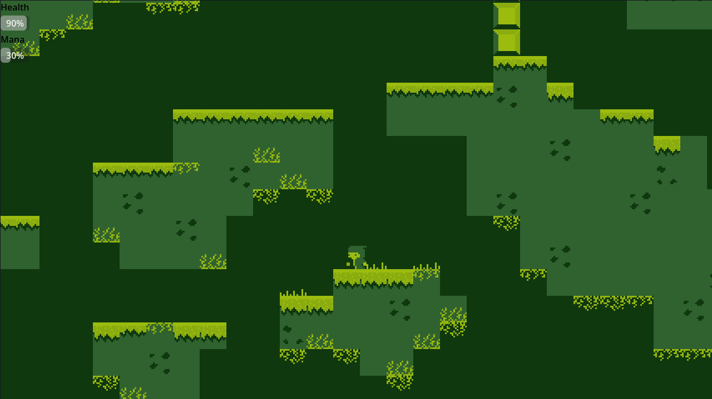

# Game Prototype

This is a small game prototype with a Game Boy-inspired art style, made using Godot.

This is my first game using Godot, so the project is also a way for me to learn and experiment with game development.

All assets in this project were drawn by me.

The game is still a *work in progress*, and many things may change in the future.

## Moviment
w - up

a - left

d - right

spacebar - dash

## Spells
left click - attack

f1 - switch magic

## Screenshot

